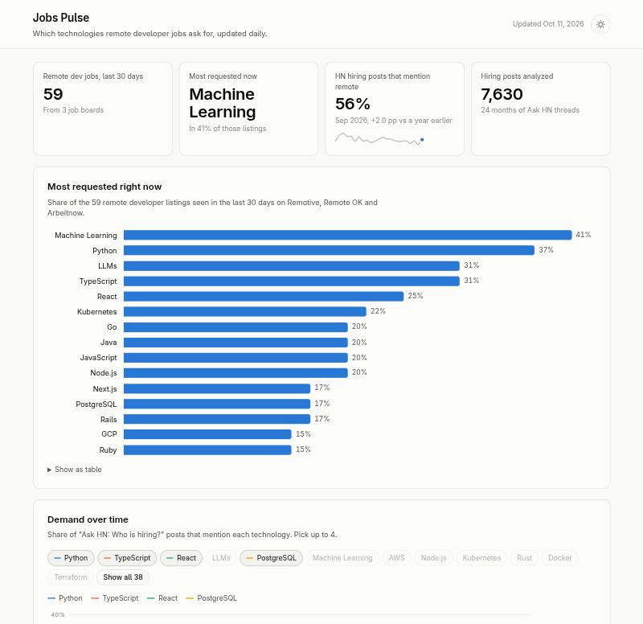

# Jobs Pulse

[](https://github.com/JoseMayo16/jobs-pulse/actions/workflows/ci.yml)
[](https://github.com/JoseMayo16/jobs-pulse/actions/workflows/update.yml)

**Which technologies do remote developer jobs ask for, and how is that changing?**

A self-updating data pipeline: every day it collects remote developer listings from public job
boards, detects the technologies each one mentions, and publishes a dashboard. It also reads
24 months of Hacker News "Who is hiring?" threads to show long-term trends.

**Live dashboard: https://josemayo16.github.io/jobs-pulse/**



## What it shows

- **Most requested right now**: share of the last 30 days of remote listings that mention each technology.
- **Demand over time**: monthly share of HN hiring posts per technology. Pick up to 4 to compare.
- **Rising and falling**: last 3 complete months against the same months a year earlier.
- **Latest listings**: searchable table; every row links back to the original post.

Every chart has a table view, keyboard-readable tooltips, and light and dark themes.

## How it works

```
 GitHub Actions (daily cron)
          │
          ▼
 ┌─────────────── fetch ───────────────┐
 │ Remotive  Remote OK  Arbeitnow  HN  │   httpx, retries, 1 req/s
 └──────────────────┬──────────────────┘
                    ▼
     normalize ─► detect skills ─► dedupe across boards
                    │
                    ▼
   data/listings.jsonl   data/hn_months.json      ◄── committed back to the repo
                    │
                    ▼
     aggregate (SQL over in-memory SQLite)
                    │
                    ▼
        site/data/summary.json ─► GitHub Pages dashboard (vanilla JS + SVG)
```

- **The repo is the database.** Listings are stored as JSON Lines sorted by key, so each daily
  commit is a readable diff of which jobs appeared or disappeared. Listings not seen for 120 days
  are pruned, so the file stays small.
- **One broken source never stops the run.** Each board is fetched independently; the run only
  fails if every source fails.
- **Cross-board duplicates are merged.** The same company and title on two boards counts once.
- **Skill detection** is a dictionary of 46 technologies with aliases (`k8s`, `Postgres`, `.NET`)
  and guards for ambiguous words: "Go" only counts inside a technology list, so "Go to our
  careers page" does not.
- **Free to run.** GitHub Actions and Pages, no server, no database service.

## Sources and terms

| Source | Access | Terms followed |
|---|---|---|
| [Remotive](https://remotive.com) | public API | link back and credit Remotive; at most 4 calls a day (this runs once) |
| [Remote OK](https://remoteok.com) | public API | link back to each job and credit Remote OK; no logo |
| [Arbeitnow](https://www.arbeitnow.com) | public API | link back; do not abuse (3 pages a day) |
| [Hacker News](https://news.ycombinator.com/submitted?id=whoishiring) | [Algolia HN API](https://hn.algolia.com/api) | only monthly counts are stored, never post text |

Job descriptions are never stored or republished: only title, company, link, date and the
detected technologies.

## Run it locally

```bash
python -m venv .venv
.venv/bin/pip install -e ".[dev]"
.venv/bin/jobs-pulse run             # fetch everything and rebuild the dashboard data
.venv/bin/jobs-pulse run --offline   # rebuild from stored data, no network
python -m http.server 8000 --directory site
```

## Tests

```bash
.venv/bin/pytest
.venv/bin/ruff check . && .venv/bin/ruff format --check .
```

Tests run against small synthetic fixtures shaped like each API response, so they need no network.
They cover every source parser, skill detection edge cases, deduplication, pruning and aggregation.

## Add a new source

Create `src/jobs_pulse/sources/<name>.py` with `NAME`, `LABEL`, `HOME`, a `fetch(client)` that
returns raw JSON and a pure `parse(raw) -> list[Listing]`, then add it to `BOARDS` in
`sources/__init__.py`. Put a trimmed sample response in `tests/fixtures/` and test `parse`.

## Deploy your own copy

1. Fork the repo.
2. Settings > Pages > Source: **GitHub Actions**.
3. Actions > "Update and deploy" > Run workflow. After that it runs every day at 06:17 UTC.

## License

MIT
